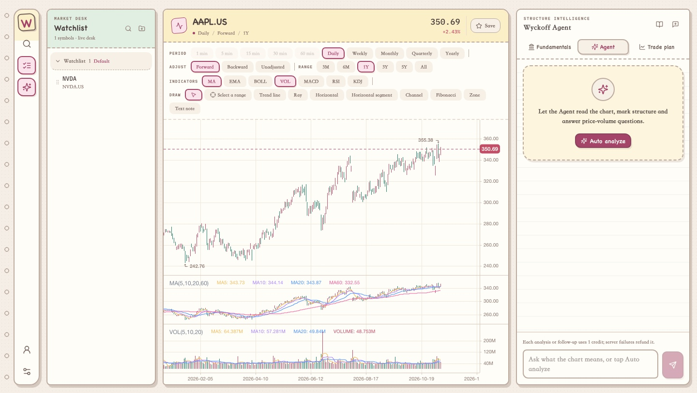

# Wyckoff Agent Workbench

**English** · [简体中文](./README.md)

An AI workspace for single-asset price-and-volume research: professional candlestick charts, Wyckoff structure analysis, semantic annotations, per-account encrypted research workspaces, and permanent analysis credits with referrals. Public charts load without signing in; watchlists, analysis and credits ask for login only when needed.

> This project is for research and education. It is not investment advice, a performance guarantee, or an automated trading service.



Open **Analysis** to switch between **Research** and **Agent**. Research merges fundamentals and a rule-based trade plan into a read-only view; Agent reads the chart, annotates structure and answers questions. Production shows friendly animated progress hints; detailed tool traces are development-only.

## Highlights

- **Browse without signing in**: the chart and workbench are the landing page; public quotes and search need no account.
- **Professional chart workspace** with zooming, panning, crosshair, timeframes, adjustments, indicators, and drawing tools.
- **Read-only research panel**: fundamentals (market cap, P/E, P/B, 52-week range, SEC filing metrics) and a rule-based trade plan (bias, trigger, entry, stop, T1/T2, risk/reward) in one view with no input. Agent chat is a separate tab.
- **Wyckoff Agent** for Phase A–E and events such as SC, AR, ST, Spring, SOS, LPS, UTAD, and SOW, rendered directly on the chart.
- **Verified accounts** via email OTP or Google; watchlists, sessions, annotations, and market caches are isolated per account.
- **Separate account panel** for login status, credits, invite code and invited users; top-ups and invites live there.
- **Permanent analysis credits**: one credit per user-initiated analysis or follow-up. Server/model failures refund automatically; history, charts, and manual annotations are free.
- **Referrals**: a new verified user receives 3 credits; each verified invite awards the inviter another 3.
- **Credit-pack top-ups** configured by the operator through `ANALYSIS_CREDIT_PACKS`, paid with Stripe Checkout.
- **English and Chinese UI**: switch language in Settings; model answers, buttons, errors and chart controls follow it.
- **Operator-only model credentials**: users cannot override the platform model URL or API key.
- **Looseleaf paper UI**: warm paper, thin borders, handwritten headings and a clean sans body. The top bar stays removed; account, settings and search sit in the watchlist header.
- **Encrypted workspaces**: each account's SQLite workspace is compressed and encrypted with AES-256-GCM before being stored in PostgreSQL.

The recommendation, scanner, AI-backtest, and user-supplied model-key surfaces are no longer mounted. Historical database rows are preserved for compatibility and are not migrated to new accounts.

## Research views

| Tab | Purpose |
| --- | --- |
| Research | Read-only. Fundamentals combine Tencent valuation data with SEC EDGAR annual facts; the trade plan is computed deterministically from Wyckoff structure, swings, ranges and ATR. |
| Agent | Interactive chart reading, annotations for ranges/events/support-resistance, and price-volume Q&A. |

Research data sources:
- Tencent quote: market cap, P/E, P/B, 52-week range (no API key).
- SEC EDGAR: US annual revenue, net income, gross/net margin, ROE, EPS and dividends (set `SEC_USER_AGENT` with contact details).
- TickFlow: candle prices shared by the chart and research panel.
- The trade plan is rule-based, not model opinion; research only, not investment advice.

New visitors see the chart and workbench first. Login appears only when they analyze, save to the watchlist, or open account credits; after signing in the pending action continues. Registration needs only email, password and an optional name; the OTP arrives by email.

Production hides structure features, candle details and tool arguments. Development shows the full trace when `ALLOW_AGENT_TRACE=1` and Vite dev mode is active. A pencil-and-dots animation explains what is happening during analysis.

## Quick start

### Requirements

- Node.js 22.x or later
- pnpm 9
- PostgreSQL (local development authenticates too)

### Install and run

```bash
pnpm install
cp .env.example .env
```

At minimum, configure:

```env
DATABASE_URL=postgres://...
BETTER_AUTH_SECRET=<at least 32 random characters>
BETTER_AUTH_URL=http://localhost:5273
WORKSPACE_ENCRYPTION_KEY=<32 random bytes as hex>
OPENAI_API_KEY=<operator model key>
SMTP_HOST=
SMTP_PORT=587
SMTP_FROM=
# Only for authenticated relays; leave empty for a local catcher.
SMTP_USER=
SMTP_PASS=
```

Then initialize the database and start the app:

```bash
pnpm -F @wyckoff/server db:migrate
pnpm dev
```

- Web app: <http://localhost:5273>
- API server: <http://127.0.0.1:8787>
- Wyckoff method reference: <http://localhost:5273/wyckoff.html>

> The dev server and `db:migrate` both read `.env` and `.env.local`; the latter wins. You can also provide configuration only through the process environment. The first search syncs the instrument directory into the current account's workspace.

Email registration requires SMTP; Google OAuth can be used on its own. If the database, auth secret, canonical URL, or workspace encryption key is missing, the UI reports that login is not configured instead of falling back to anonymous mode.

## Credits and top-ups

- A verified new account receives 3 permanent credits once; they do not reset monthly.
- Each user-initiated analysis or follow-up consumes 1 credit. Model/server failures refund it.
- A successful request with the same `Idempotency-Key` never charges twice; a failed, refunded request may retry with the same key.
- Credit-pack price and units come from the server-side order snapshot; clients cannot submit amounts.
- Payment confirmation is based on verified Stripe callbacks. Replays never add credits twice.
- Purchases stay unavailable until a merchant is configured; free credits and referrals still work.

See [Stripe payment setup](docs/payment-setup.md) for the full configuration and testing checklist.

## Environment variables

| Variable | Purpose |
| --- | --- |
| `TICKFLOW_BASE_URL` / `TICKFLOW_API_KEY` | Market-data endpoint and optional paid key |
| `OPENAI_BASE_URL` / `OPENAI_API_KEY` / `OPENAI_MODEL` | Operator-only model configuration |
| `OPENAI_WEB_SEARCH` | Enables Responses `web_search` |
| `DEBUG_LLM` | Set to `1` only to log full prompts/history; off by default |
| `ALLOW_AGENT_TRACE` | Set to `1` only in development to stream tool traces; keep `0` in production |
| `SEC_USER_AGENT` | SEC EDGAR identifying string with contact details; empty disables SEC filing data |
| `DATABASE_URL` / `DATABASE_SSL_CA` | PostgreSQL connection and optional CA |
| `BETTER_AUTH_SECRET` / `BETTER_AUTH_URL` | Auth secret and canonical site origin |
| `GOOGLE_CLIENT_ID` / `GOOGLE_CLIENT_SECRET` | Google OAuth |
| `SMTP_HOST` / `SMTP_PORT` / `SMTP_USER` / `SMTP_PASS` / `SMTP_FROM` | OTP email and password reset |
| `WORKSPACE_ENCRYPTION_KEY` | 32-byte hex; changing it makes old workspaces unreadable |
| `ANALYSIS_CREDIT_PACKS` | JSON array; empty disables purchases |
| `BILLING_PUBLIC_ORIGIN` | HTTPS origin for checkout returns and provider callbacks |
| `STRIPE_SECRET_KEY` / `STRIPE_WEBHOOK_SECRET` | Stripe one-time Checkout; server-side only, no publishable key required |
| `PG_POOL_MAX` | PostgreSQL pool size, default 10 |
| `PORT` / `DATA_DIR` | Local port and SQLite directory |

See [`.env.example`](./.env.example) for the complete template.

## Commands

```bash
pnpm dev          # run web and API services
pnpm -F @wyckoff/server db:migrate  # auth, workspace, billing, and credit tables
pnpm typecheck    # TypeScript checks for the whole workspace
pnpm test         # all tests
pnpm lint         # ESLint
pnpm build        # production build
```

PostgreSQL integration tests need a disposable database:

```bash
TEST_DATABASE_URL=postgres://... pnpm -F @wyckoff/server test
```

## Repository layout

```text
apps/web                 React + Vite product UI
apps/server              Hono API, auth, credits, payments, encrypted workspaces
packages/shared          Shared types, Zod protocols, and API contracts
packages/wyckoff         Features, structures, and deterministic backtest engine (library)
docs/                    Deployment, account, payment, and screenshot docs
data/                    Local SQLite cache (Git ignored)
```

## Implementation principles

- The Agent returns domain semantics rather than pixel coordinates; the frontend maps them onto chart overlays.
- Credits are reserved, consumed, or refunded in the same transaction that persists the workspace snapshot.
- Workspace writes use PostgreSQL row locks and a version CAS; read-only requests do not reserialize unchanged data.
- Near the 64 MiB cap, re-fetchable market caches are evicted automatically; user annotations, sessions, and favorites are never discarded.
- Payment amounts, credits, currency, and orders are server-snapshotted; callbacks must pass signature and amount checks.
- Users cannot override the model URL, model ID, or API key; operator credentials come only from the environment.
- Production Agent responses contain only text, annotations and progress; `tool_start`/`tool_end` and tool arguments are filtered by the server.
- The research panel is a read-only data view; it never calls the model and does not consume analysis credits.
- Language and theme are stored in the browser; previews accept `?lang=zh|en`, `?theme=light|dark`, `?auth=1` and `?account=1`.

## Deployment

See [Vercel deployment](docs/vercel-deployment.md) for deployment, migrations, environment variables, and concurrency limits, and [account setup](docs/account-setup.md) for login and referral behavior.
