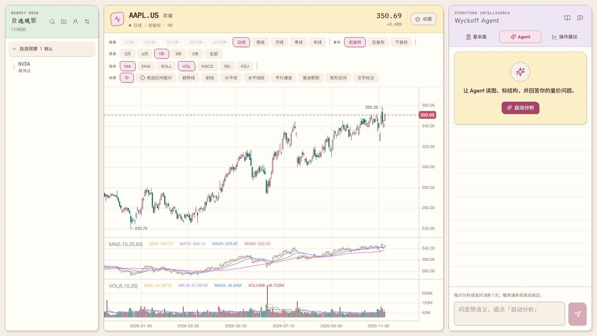

# Wyckoff Agent Workbench

[English](./README.en.md) · **简体中文**

面向单标的量价研究的 AI 工作台：专业 K 线画布、Wyckoff 结构分析、语义标注、按账号加密保存的研究工作区，以及永久分析次数与邀请机制。

> 本项目用于研究与教育，不构成投资建议、收益承诺或自动交易服务。



点击「分析」打开研究面板，再点「自动分析」，Agent 会把交易区间、Wyckoff 事件、支撑阻力与趋势线绘制到 K 线画布，并在右侧保留分析与工具轨迹。

## 核心功能

- **专业 K 线工作台**：缩放、平移、十字光标、多周期、复权、指标与绘图工具。
- **Wyckoff Agent**：识别 Phase A–E、SC、AR、ST、Spring、SOS、LPS、UTAD、SOW 等结构，并直接绘制到图表。
- **账号与研究历史**：邮箱验证码或 Google 登录；自选、会话、标注与行情缓存按账号隔离。
- **永久分析次数**：每次主动分析或追问消耗 1 次；服务端失败自动返还；查看历史、图表和手动标注不扣次。
- **邀请奖励**：新用户验证后获赠 3 次；每邀请一位完成验证的新用户，邀请人再获赠 3 次。
- **充值次数包**：运营方通过 `ANALYSIS_CREDIT_PACKS` 配置永久次数包；支持 Stripe 与微信 Native 支付。
- **安全边界**：模型凭据只存在于服务端环境变量，用户不能覆盖平台模型地址或密钥。
- **加密工作区**：每个账号的 SQLite 工作区压缩后使用 AES-256-GCM 加密，存入 PostgreSQL。

已移除的荐股、扫描、AI 回测和用户自带模型 Key 入口不再挂载；旧数据库记录保留作兼容，不会自动迁移到新账号。

## 快速开始

### 环境要求

- Node.js 22.x 或更高版本
- pnpm 9
- PostgreSQL（本地开发同样需要，登录与额度是强制路径）

### 安装与启动

```bash
pnpm install
cp .env.example .env
```

至少填写以下配置：

```env
DATABASE_URL=postgres://...
BETTER_AUTH_SECRET=<至少 32 字符随机值>
BETTER_AUTH_URL=http://localhost:5273
WORKSPACE_ENCRYPTION_KEY=<32 字节随机值的 hex>
OPENAI_API_KEY=<运营方模型 Key>
SMTP_HOST=
SMTP_PORT=587
SMTP_FROM=
# Only for authenticated relays; leave empty for a local catcher.
SMTP_USER=
SMTP_PASS=
```

然后初始化数据库并启动：

```bash
pnpm -F @wyckoff/server db:migrate
pnpm dev
```

- 前端：<http://localhost:5273>
- 后端：<http://127.0.0.1:8787>
- Wyckoff 方法说明：<http://localhost:5273/wyckoff.html>

> 开发服务器与 `db:migrate` 都会读取 `.env` 和 `.env.local`，后者优先。也可以只通过进程环境变量提供配置。首次启动会同步标的索引到当前账号的工作区。

邮箱注册需要 SMTP；只配置 Google OAuth 时也可以使用 Google 登录。没有数据库、认证密钥、站点地址或工作区加密密钥时，界面会明确显示登录服务未就绪，而不会退回到匿名模式。

## 分析次数与充值

- 新账号验证成功后一次性获得 3 次，不按月刷新。
- 每次用户主动提交的分析或追问消耗 1 次；模型/服务端失败会返还。
- 同一 `Idempotency-Key` 的成功请求不会重复扣次；失败并已返还的请求允许用同一 key 重试。
- 充值次数包由运营方配置，价格和次数以服务端订单快照为准，客户端不能传金额。
- 支付成功以验签后的 Stripe/微信回调为准；重复回调不会重复加次数。
- 未配置商户时购买入口保持不可用，但免费次数与邀请仍然生效。

完整配置和商户开通步骤见 [支付开通说明](docs/payment-setup.md)。

## 环境变量

| 变量 | 说明 |
| --- | --- |
| `TICKFLOW_BASE_URL` / `TICKFLOW_API_KEY` | 行情地址与可选付费 Key |
| `OPENAI_BASE_URL` / `OPENAI_API_KEY` / `OPENAI_MODEL` | 运营方模型配置，用户不可覆盖 |
| `OPENAI_WEB_SEARCH` | 是否启用 Responses `web_search` |
| `DEBUG_LLM` | 设为 `1` 时才打印完整 prompt/历史，默认关闭 |
| `DATABASE_URL` / `DATABASE_SSL_CA` | PostgreSQL 连接与可选 CA |
| `BETTER_AUTH_SECRET` / `BETTER_AUTH_URL` | 认证密钥与固定站点 origin |
| `GOOGLE_CLIENT_ID` / `GOOGLE_CLIENT_SECRET` | Google OAuth |
| `SMTP_HOST` / `SMTP_PORT` / `SMTP_USER` / `SMTP_PASS` / `SMTP_FROM` | 邮箱验证码与密码找回 |
| `WORKSPACE_ENCRYPTION_KEY` | 32 字节 hex；变更后旧工作区无法解密 |
| `ANALYSIS_CREDIT_PACKS` | JSON 数组；留空则关闭购买 |
| `BILLING_PUBLIC_ORIGIN` | 支付回跳与回调使用的 HTTPS origin |
| `STRIPE_SECRET_KEY` / `STRIPE_WEBHOOK_SECRET` | Stripe 一次性 Checkout |
| `WECHAT_*` | 微信支付 API v3 Native 配置 |
| `PG_POOL_MAX` | PostgreSQL 连接池大小，默认 10 |
| `PORT` / `DATA_DIR` | 本地端口与 SQLite 目录 |

完整模板见 [`.env.example`](./.env.example)。

## 常用命令

```bash
pnpm dev          # 同时启动前后端
pnpm -F @wyckoff/server db:migrate  # 创建认证、工作区、账单与额度表
pnpm typecheck    # 全仓 TypeScript 检查
pnpm test         # 全量测试
pnpm lint         # ESLint
pnpm build        # 生产构建
```

集成测试需要一个可清空的 PostgreSQL：

```bash
TEST_DATABASE_URL=postgres://... pnpm -F @wyckoff/server test
```

## 项目结构

```text
apps/web                 React + Vite 产品界面
apps/server              Hono API、认证、额度、支付与加密工作区
packages/shared          共享类型、Zod 协议与 API 契约
packages/wyckoff         特征、结构与确定性回测引擎（库）
docs/                    部署、账号、支付与截图
data/                    本地 SQLite 缓存（Git ignored）
```

## 关键实现原则

- Agent 只输出领域语义，不输出像素坐标；前端负责映射到 K 线图层。
- 分析次数在写入工作区快照的同一事务中预占、消费或返还。
- 工作区写入使用 PostgreSQL 行锁与版本 CAS；只读请求不重复序列化未变化的数据。
- 接近 64 MiB 上限时自动丢弃可重新拉取的行情缓存；用户标注、会话和收藏不会被清理。
- 支付金额、次数、币种与订单都由服务端快照决定，回调必须通过签名与金额校验。
- 用户不能覆盖模型地址、模型 ID 或 API Key；运营方凭据只从环境变量读取。

## 部署

云端部署、迁移、环境变量与并发限制见 [Vercel 部署说明](docs/vercel-deployment.md)，登录与邀请流程见 [账号配置](docs/account-setup.md)。
